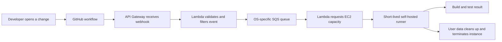
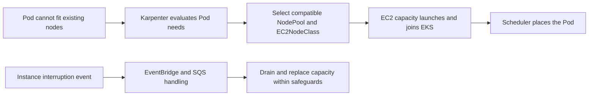
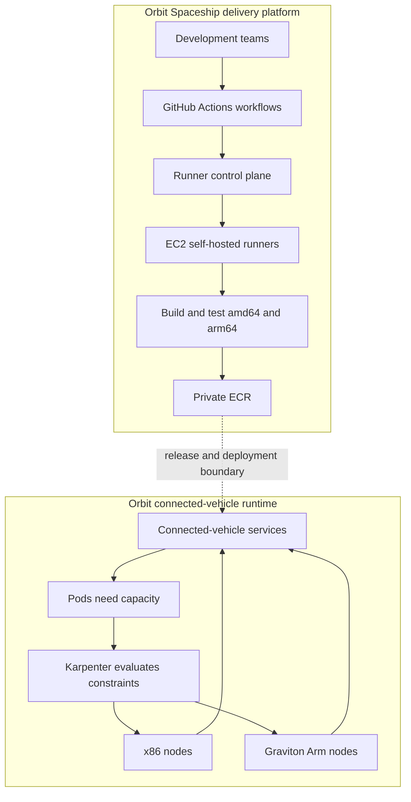

# BMW Connected Vehicle Platform: A Simple Case Study

This guide connects three AWS stories about BMW Connected Company's
connected-vehicle platform: modernizing its software delivery system,
improving how Kubernetes obtains compute capacity, and migrating workloads
from x86 CPUs to AWS Graviton (Arm).

> **Scope note:** BMW's Connected Vehicle platform is a different platform
> from BMW's enterprise Cloud Data Hub (CDH). The lessons here are useful
> for platform and architecture interviews, but these articles do not say
> that CDH uses this same runtime, CI/CD design, Karpenter setup, or Graviton
> migration.

The names are easy to confuse: **Orbit** is the Connected Vehicle runtime
platform, while **Orbit Spaceship** is the Cloud Developer Platform that
builds and deploys software. The CI/CD article describes how Spaceship later
integrated with Orbit; it does not mean the two names refer to the same
component.

## The Story in One Minute

BMW runs digital services that communicate with a large connected-vehicle
fleet. As the number of services and teams grew, BMW needed a delivery
platform that could handle many builds, and a runtime platform that could
obtain suitable compute capacity quickly and efficiently.

For scale, the Karpenter article describes more than 375 EKS clusters
processing over 12 billion requests and 145 TB of traffic daily across four
AWS Regions. The Graviton article describes a fleet of more than 24.5
million connected vehicles. These are figures from different article
snapshots, not one synchronized measurement.

The articles also describe different points in the journey: BMW's
Connected Vehicle backend migration to AWS began in 2019, the CI/CD
modernization began in 2020, and the Graviton migration began in 2024.
Karpenter and Graviton are later platform improvements, not one initial
cloud migration.

The three stories address different layers of that problem:

| Layer | Change |
| --- | --- |
| Delivery | On-demand GitHub Actions runners |
| Capacity | Karpenter provisions nodes for pending Pods |
| Architecture | Arm-based Graviton alongside x86 |

These are complementary improvements, not one feature. Faster pipelines
help teams release; better node provisioning helps workloads get capacity;
and Arm instances provide another compute option. Each change still needs
reliability, security, and rollback controls.

## A Simple Mental Model

Think of a large delivery company:

- **CI/CD is the workshop:** it checks a change, builds the package, and
  prepares it for delivery.
- **Karpenter is the dispatcher:** it sees work that cannot be scheduled
  and requests a suitable worker (a Kubernetes node).
- **Graviton is another kind of engine:** a workload may use it if its
  software and dependencies support that CPU architecture.

The analogy is only a starting point. Real systems also need capacity
limits, security boundaries, health checks, failure recovery, and safe
ways to change or undo a rollout.

## 1. Modernizing the Build and Deployment Platform

Primary source: [AWS's CI/CD modernization article](https://aws.amazon.com/blogs/migration-and-modernization/an-engine-of-efficiency-bmw-groups-ci-cd-modernization-journey-with-aws/).

### The problem

BMW's original CI/CD setup ran on premises with OpenShift and Jenkins. It
had a small central pool of about 10 always-available workers, plus
product-specific administration nodes and custom jobs. This could waste
capacity when teams were idle and create contention when many builds arrived.

BMW's Cloud Developer Platform, called **Orbit Spaceship**, evolved to
support over 130,000 builds and deployments per day, over 1,300
microservices, hundreds of AWS accounts, and more than 3,000 developers.
The platform also offered 50 reusable pipeline building blocks. These are
figures reported in the CI/CD article, not a claim about today's exact
totals.

### How the platform evolved

The CI/CD article is a journey through several architectures, not a
description of one fixed design:

1. **Foundation: extend Jenkins to AWS.** EC2 workers provided more elastic capacity.
   AWS Direct Connect kept the cloud setup connected to on-premises
   systems; Vault and Consul handled secrets and configuration, while
   Nexus and SonarQube supported artifacts and code quality. This
   intermediate phase handled about 3,000 build hours and several
   thousand builds per day.
2. **Innovation: build Orbit Spaceship v1.** GitHub Actions replaced the shared
   Jenkins worker pool. API Gateway and Lambda filtered GitHub webhooks,
   then sent valid work to OS-specific SQS queues. Queue consumers
   launched EC2 instances that registered as self-hosted runners.
3. **Speed: reduce runner wait time.** Pre-warmed EC2 Auto Scaling groups
   provided ready machines, reducing runner provisioning from about
   2.5 minutes to 18 seconds. During this phase, the team also moved
   runner images from Amazon Linux to Ubuntu for tool compatibility.
4. **Efficiency: add Arm builds.** Graviton runners gave teams native Arm build
   capacity and a lower-cost option for compatible workloads.
5. **Expansion: support mobile builds.** EC2 Mac instances ran macOS VMs using
   Tart and Packer-built images with Xcode and simulators. The article
   reports a representative iOS build falling from 90 minutes on an
   on-premises M1 Mac mini to 35 minutes on an EC2 M4 Mac.
6. **Scale: optimize at higher volume.** At more than 50,000 builds per day,
   public dependency downloads caused rate limits and network costs.
   JFrog Artifactory cached dependencies, and custom AMIs included
   common tools such as Java, Python, Terraform, and Node.js. The
   serverless control plane could scale to zero during quiet periods.
7. **Global reach: integrate with Orbit.** To align with the
   shared EKS runtime, BMW moved some Lambda control-plane services
   onto EKS and replaced SQS with RabbitMQ. EC2 remained the runner
   substrate.

### How an on-demand runner works

A **runner** is the machine that executes a CI job. BMW's approach uses
self-hosted GitHub Actions runners and launches compute when jobs arrive.
The diagram below shows the early Orbit Spaceship v1 flow, not the later
RabbitMQ-based control plane:

The queue separates incoming requests from the slower work of preparing
machines. This is useful when many builds arrive together: the system can
accept and buffer work, then process it at a controlled rate. Filtering
webhooks before provisioning also avoids launching machines for invalid or
irrelevant events.

The runners are **ephemeral**: they are created for jobs and removed
afterward. A fresh environment reduces leftover files and configuration
from previous jobs, makes builds more repeatable, and avoids paying for
idle machines indefinitely. The trade-off is startup time: provisioning a
new machine for every job can make builds feel slow.

BMW addressed startup delay with **pre-warmed capacity**. Some EC2
instances are prepared in advance, so a runner can be registered without
waiting for a full machine boot. In the next part of the journey, the
article reports reducing runner provisioning time from about 2.5 minutes
to 18 seconds.

### Reported CI/CD results

The article reports that the ephemeral-runner approach reduced costs by
63% and increased parallel execution capacity by 50%. In its later
conclusion, the article describes runner provisioning in under 10 seconds
and a 50% reduction in maintenance and operational tasks. These results
refer to different stages and measures; they should not be presented as a
63% reduction in BMW's total cloud bill or as one controlled benchmark.

The Mac build result is another distinct measure: the article reports a
61% reduction in one average iOS build time, from 90 to 35 minutes. It
does not describe every build or every workload.

The macOS phase solved a separate isolation and licensing constraint:
EC2 Mac runs on bare-metal hosts with a 24-hour minimum host billing
period, while ephemeral build jobs need a clean environment. BMW used
Tart virtual machines on the Mac hosts, with Packer-built images that
included multiple Xcode versions and simulators. This allowed the job
environment to be recreated quickly without treating the whole host as
the per-job disposable unit. Tart uses Apple's Virtualization framework,
and the article reports that these prepared VMs boot in seconds.

### Concepts to take away

- **Queueing smooths bursts:** incoming events do not have to wait for a
  runner to finish provisioning before they can be accepted.
- **Ephemeral workers improve isolation:** each job starts with a cleaner
  environment, but the platform must manage provisioning latency.
- **Warm pools trade idle cost for responsiveness:** keep enough capacity
  warm to meet latency goals, but scale it to avoid excessive idle spend.
- **Reusable pipeline components reduce drift:** teams can share tested
  steps for common tasks without duplicating every workflow.
- **The platform needs guardrails:** validate webhook authenticity, limit
  runner permissions, protect secrets, and clean up even after failed jobs.
- **Keep runner images reproducible:** pre-baking common tools can reduce
  setup time, but images still need patching, scanning, and versioning.

### What changed in the later global design

The later architecture decomposed runner management into four services:
Runner Controller orchestrated work; a GitHub service handled webhooks and
tokens; a Cloud service managed EC2 instances and Auto Scaling groups; and
a Metrics service reported usage and performed periodic processing and
cleanup.

MongoDB stored information needed to correlate different webhook payloads.
The platform sent collected metrics to BMW's central data lake for analysis.
Runner assignment times fed self-healing logic for jobs that waited too
long. EC2 runner agents used RabbitMQ messages to register and confirm
availability. These changes illustrate that the event and control-plane
components evolved as operational needs changed, while EC2 remained the
build compute. Keeping GitHub-related data locally also reduced GitHub API
calls and supported inventory management across multiple Auto Scaling
groups.

### Operational lessons from the full CI/CD journey

- **Cache dependencies close to the build fleet.** Artifactory reduced
  public-registry rate limiting and network transfer. The article also
  discusses IPv6-capable egress as a way to reduce NAT gateway traffic
  costs where network and security requirements allow it.
- **Choose discounts based on the shape of demand.** BMW found Savings
  Plans could be more economical than Spot for predictable, high-volume
  runner usage, avoiding interruption handling complexity.
- **Measure ephemeral-resource overhead.** Frequent instance creation
  increased AWS Config evaluations and cost; compliance coverage still
  matters, so tune evaluation frequency only with security approval.
- **Use metrics to tune capacity.** CPU, memory, disk, and runner wait
  time informed instance choices and self-healing behavior. The article
  describes machine-learning-based instance selection as a future plan,
  not a completed capability.

## 2. Scaling Kubernetes Nodes with Karpenter

Primary source: [AWS's BMW Karpenter migration article](https://aws.amazon.com/blogs/industries/transforming-the-bmw-connected-vehicle-backend-with-karpenter/).

### First: what is a Kubernetes node?

Kubernetes runs applications in **Pods**. A Pod needs CPU, memory, storage,
and sometimes a specific CPU architecture or hardware type. The Kubernetes
scheduler places a Pod on a node that has enough compatible capacity.

If no existing node can run a Pod, the Pod remains pending. A cluster
autoscaler can then request more nodes. Adding a node is not instant: the
cloud must launch the virtual machine, it must join the cluster, and its
container runtime must become ready.

### Cluster Autoscaler and Karpenter

BMW had used Kubernetes Cluster Autoscaler (CAS). In a common CAS
configuration, the autoscaler adjusts capacity in preconfigured node
groups. At BMW's scale, managing many Auto Scaling groups became harder
while maintaining application availability, moving quickly during cluster
upgrades, and meeting security requirements.

Karpenter instead evaluates pending Pods and the constraints in its
configuration, then provisions compatible EC2 instances directly through
the EC2 APIs. In current
Karpenter terminology, a **NodePool** describes workload and capacity
constraints, while an **EC2NodeClass** describes AWS-specific launch
details such as networking, security groups, and AMI selection.

The point is not just to create a node sooner. Karpenter can choose from
more instance types, pack workloads onto capacity more efficiently, and
place capacity across Availability Zones according to constraints. Its
drift detection can also identify nodes that no longer match the desired
AMI or configuration and replace them. These capabilities still need
limits, disruption budgets, and application-level availability planning.

- **Cluster Autoscaler:** common setups scale preconfigured node groups.
- **Karpenter:** selects compatible EC2 capacity from pending Pod
  requirements and configured constraints.

This is a simplified comparison: actual behavior depends on configuration,
Kubernetes version, and the provider integration. Karpenter still needs
careful limits and policies; it is not an unlimited or automatically
optimal capacity source.

### BMW's migration approach

The AWS article describes the Connected Vehicle backend at a scale of more
than 375 EKS clusters, over 1,300 microservices, four AWS Regions, and
roughly 12 billion requests and 145 TB of traffic per day. Treat these as
the article's reported snapshot.

BMW's migration had a proof-of-concept phase followed by a controlled
production rollout:

1. **Automate the proof of concept.** Terraform and GitHub Actions
   provisioned Karpenter instead of an operator running ad hoc CLI
   commands. BMW configured IAM, subnet and security-group tags, and
   cluster access for the new nodes. The article names the `aws-auth`
   ConfigMap; EKS access mechanisms vary by cluster version, so preserve
   the principle of explicit node authorization rather than copying that
   exact mechanism blindly.
2. **Keep Karpenter on stable capacity.** A dedicated, tainted managed
   node group ran Karpenter. This avoids a bootstrap dependency where the
   autoscaler cannot start because it has no node on which to run.
3. **Match capacity policies to workloads.** Separate NodePools and
   EC2NodeClasses supported stateless, stateful, and GPU workloads.
   Affinity rules kept critical workloads on appropriate capacity.
4. **Switch gradually.** A `use_karpenter` feature flag enabled selective
   cluster activation. Pre-flight checks verified readiness
   before old managed node groups were drained. Cluster Autoscaler (CAS)
   was scaled to zero during the transition to prevent competing
   provisioning decisions.
5. **Observe and handle interruptions.** Dashboards tracked provisioning
   and Karpenter behavior. The platform VPC used EventBridge and SQS for
   instance termination handling. The architecture supported On-Demand
   and Spot capacity, but the article says further savings were expected
   as Spot adoption expanded.
6. **Retain a rollback path.** If rollout health regressed, the documented
   plan was to disable Karpenter through infrastructure-as-code, restore
   CAS scaling and managed-node-group limits, remove Karpenter resources
   and custom resources, and clean up remaining cloud resources.

After migration, Cluster Autoscaler and the old managed node groups could
be decommissioned. The EKS platform VPC also connected to product VPCs
through VPC peering, allowing services to reach product resources such as
RDS. This is a separate networking concern from node provisioning, but it
matters to the complete runtime architecture.

NodePool disruption budgets limited how many nodes could be replaced at
once. They reduce correlated disruption but do not guarantee that
applications will never be interrupted; PodDisruptionBudgets, replicas,
quorum, and recovery capacity still matter.

### What Karpenter does when a Pod is pending

This is a simplified flow. Karpenter provisions capacity for unschedulable
Pods, but Kubernetes still schedules the Pods after nodes become ready.
Interruption handling, drain behavior, and replacement timing depend on
the configured Karpenter version, workload protections, and AWS event
setup.

### Practical issues BMW encountered

The migration also shows why autoscaling is not just "turn on a controller":

- **Node storage was too small for large images.** The default 20 GB of
  ephemeral capacity was insufficient for some stateless node pools, so
  BMW added EBS storage mappings.
- **Image pulls were slow under load.** BMW increased kubelet
  `registryPullQPS` from 5 to 50 to handle its registry demand. This is a
  BMW-specific tuning result, not a universal recommendation; registry
  capacity, network limits, and retry behavior should be measured first.
- **Too many nodes could be disrupted together.** BMW reduced the
  configured NodePool disruption budget to 10% to limit simultaneous
  replacements. That value reflects its environment and should not be
  copied without checking service redundancy, PodDisruptionBudgets, and
  recovery capacity.

### Reported Karpenter results

The article reports two different result scopes:

- In the proof of concept, CPU utilization increased by about 9% and
  hourly cost decreased by about 13%.
- In the broader results, CPU utilization improved from about 84% to 93%,
  and total CPU core counts fell by about 10-16% across environments.
- The production migration resulted in more than $1 million in reported
  annual AWS infrastructure savings.

These numbers are specific to BMW's measurements and workloads. Higher
utilization is useful only when there is still enough headroom for traffic
spikes, failures, and maintenance. The article attributes the measured
gains primarily to bin-packing and dynamic provisioning; it expected
additional savings as Spot adoption expanded. The reported 10-16% CPU-core
reduction varied with compaction-budget settings, cluster sizes, and
workload characteristics.

## 3. Moving Workloads to AWS Graviton

Primary source: [AWS's Graviton migration article](https://aws.amazon.com/blogs/architecture/how-bmw-group-accelerated-connected-vehicle-workloads-on-aws-graviton/).

### What does "move from x86 to Arm" mean?

The processor architecture determines which machine instructions a
program can run. Much server software is portable, but an application can
still depend on architecture-specific pieces such as native libraries,
compiled extensions, container base images, or vendor agents.

AWS Graviton instances use Arm processors. The opportunity is to test
whether compatible workloads can achieve better price-performance or use
less compute for the same work. It is not safe to assume that every
container will run unchanged or that every workload will become faster.

BMW's first test used dedicated Graviton CI runners alongside the existing
x86 runners and a small set of self-contained services. The team saw
faster builds and lower cost per build minute, then expanded the approach
through two tracks: produce images for both architectures, and make Arm
capacity available in the shared EKS hosting platform. The AWS article
groups the work into build-foundation and workload-migration phases so
application teams could adopt independently of platform preparation.

### Build one image reference for two architectures

For a containerized service to run on both x86 (`amd64`) and Arm (`arm64`),
the image must include a compatible variant for each architecture. An OCI
image index (often called a multi-architecture manifest) can point one
image reference to the architecture-specific images. When a node pulls
that reference, the container runtime selects the matching variant.

BMW used two ways to build these images:

- **Emulation with Buildx and QEMU:** convenient for simpler builds, but
  emulation can be slower and may not expose every architecture-specific
  issue as clearly.
- **Native builds on Graviton runners:** execute the build on Arm hardware,
  which is useful for complex or long-running builds and for finding
  architecture-specific failures earlier.

For a native build, each architecture can be built on its own runner and a
final pipeline step creates the shared image index. QEMU can build all
architectures from one runner, but compute-intensive builds may be much
slower. BMW supported both paths through reusable GitHub Actions
workflows: simple Dockerfiles could use QEMU, while complex builds, large
dependency downloads, or long build times favored native runners.

Most application Dockerfiles needed no changes because the base image and
dependencies already supported Arm. Some teams had to replace a dependency
or find an Arm-compatible version. Runner labels mirrored existing labels,
so in many cases the first build opt-in was simply changing an `x64` runner
label to `arm64`.

Public base images were mirrored into private ECR for availability,
immutability, and vulnerability-management requirements. BMW used Google's
Crane tool to copy images while filtering the OCI index to the platforms
actually needed, avoiding storage for unused variants. The important idea
is to preserve the manifest and verify both image variants after mirroring.

### Let services opt in gradually

BMW kept x86 capacity available while adding shared, general-purpose
Graviton node pools. Taints prevented workloads from landing on Arm nodes
accidentally; a workload needed a matching toleration and scheduling
selection to opt in. A preferred node-affinity rule could favor `arm64`
without making Arm a hard requirement. This let the platform prefer the
new capacity while retaining scheduling flexibility where policy allowed.

The migration started with a small set of self-contained services. BMW
then validated core platform services, including Karpenter, Prometheus,
and operational tooling, before broad application adoption. Application
teams could move at their own pace while the existing x86 path remained
available.

For the final recovery step, BMW's Argo CD-based GitOps deployment model
could restore the prior desired state by reverting the change in Git and
letting Argo CD reconcile the cluster. That still depends on maintaining
compatible `amd64` images, enough x86 capacity, and correct scheduling
rules; rollback is a tested procedure, not an automatic property of
having two CPU architectures.

This strategy reduces risk because it separates several questions:

1. Can the application and all dependencies run correctly on Arm?
2. Does it meet latency, throughput, and reliability targets?
3. Does it improve cost or performance for this workload?
4. Can the team safely shift back to x86 if a problem appears?

Rollback still needs planning: confirm an amd64 image exists, that x86
capacity is available, and that scheduling and deployment controls can
move the workload back safely.

### Reported Graviton results

The AWS article reports approximately $600,000 in annualized
infrastructure savings. For the NGINX-based ingress controller, it
reports about 57% lower CPU consumption at the same ingress profile and
around 40% better price-performance. It also reports that more than 65%
of the platform ran on Graviton across production environments at the
time of publication.

These figures have different scopes: the savings are for the reported
migration, while the CPU and price-performance figures are specifically
for the ingress-controller comparison. Do not add these results to the
CI/CD results or Karpenter's more-than-$1-million savings; their
baselines, time periods, and scopes differ and could overlap. The article
describes Graviton as the default compute path; more than 65% is its
reported production adoption level at publication time.

## How the Three Improvements Fit Together

This diagram combines the ideas from the three articles. It is a
conceptual view, not a claim that the articles publish this exact
end-to-end architecture:

This separates what the articles describe as distinct layers. In the later
CI/CD design, some runner-control services also moved onto EKS, but the
articles do not define one end-to-end deployment topology or say that every
application followed this exact path.

The main principle is to make each layer support the next one:

- CI needs reliable builds for every architecture that production may run.
- The registry needs to preserve the architecture variants and deliver
  images quickly.
- Kubernetes needs safe scheduling rules and enough capacity during
  rollout or failure.
- Applications need tests and observability that compare the two
  architectures using real service-level outcomes.

## Example: A Service Fails After Opting Into Arm

Imagine a service works on x86 but crashes after being scheduled onto an
Arm node.

1. **Check what changed.** Confirm the node architecture and the image
   digest deployed to the Pod.
2. **Inspect the image index.** Verify that the referenced image contains
   an `arm64` variant, not just an `amd64` image.
3. **Inspect startup logs and exit reason.** A native library or compiled
   dependency may be missing or incompatible. Do not infer the cause from
   the exit code alone.
4. **Restore service safely.** Shift the workload back to compatible x86
   capacity if needed, while preserving enough capacity and respecting
   availability constraints.
5. **Fix the delivery path.** Add native Arm testing or dependency checks
   so the pipeline catches the issue before the next rollout.
6. **Compare after recovery.** Verify latency, errors, saturation, and
   cost before attempting another gradual rollout.

This is why multi-architecture support is both a build problem and an
operations problem.

## Interview Questions and Short Answers

**Why did BMW make runners ephemeral?**  
To start builds in a clean environment, reduce cross-build contamination,
and avoid keeping a large worker fleet idle. The platform then had to
manage machine startup latency, which pre-warmed capacity helped reduce.

**Why use a queue between webhook handling and runner provisioning?**  
It decouples quick event acceptance from slower machine provisioning,
buffers bursts, and lets workers process requests asynchronously.

**Did the runner platform stay serverless?**  
Not entirely. The early Orbit Spaceship v1 control plane used Lambda and
SQS. As BMW integrated with the shared EKS-based Orbit platform, it moved
some control services onto EKS and replaced SQS with RabbitMQ, while
keeping EC2 as the runner compute. The evolution reflects platform
alignment and operational trade-offs, not a claim that one design is
universally better.

**How is Karpenter different from Cluster Autoscaler?**  
In the described approach, Karpenter evaluates pending Pod requirements
against provisioning policies and launches compatible EC2 capacity
directly. A common Cluster Autoscaler setup changes the size of
preconfigured node groups. Both need limits and disruption safeguards.

**Why keep Karpenter on a managed node group?**  
To avoid making the component that creates capacity depend entirely on
capacity that it itself has to create.

**Why not move every service to Graviton at once?**  
Some dependencies may be architecture-specific, and performance differs
by workload. A gradual opt-in rollout lets teams validate correctness,
service objectives, and cost while retaining a tested x86 fallback.

**What is the purpose of an OCI image index?**  
It lets one image reference point to architecture-specific variants so
the runtime can select the compatible image for the node.

**Why not use Spot for all build and application capacity?**  
Spot can lower rates but can be interrupted and requires a reliable
recovery path. The CI/CD article says BMW found Savings Plans could be
more economical for predictable, high-volume runner use. The Karpenter
article reports further savings expected from expanding Spot adoption.
The right choice depends on workload flexibility, utilization, and
interruption cost.

**What would you monitor during these changes?**  
For CI/CD, track queue depth, runner assignment and startup time, failed
registration, build duration, cleanup, and cost per successful build. For
Karpenter, track pending Pod age, node launch and readiness time,
disruption events, and spare capacity. For applications, compare
availability, latency, errors, saturation, and cost by architecture
against service objectives.

**What is the broader architectural lesson?**  
BMW improved the developer workflow, the way runtime capacity is chosen,
and the processor options available to workloads. The migration was
incremental: measure, establish a safe path, opt in, observe, and retain
a way to recover. The CI/CD story also shows that the control plane can
evolve as scale exposes new bottlenecks.

## A 90-Second Interview Summary

> BMW Connected Company's AWS stories describe three related platform
> improvements. Its CI/CD platform evolved from Jenkins on premises to
> elastic GitHub Actions runners, pre-warmed EC2 capacity, dependency
> caching, and later integration with the EKS-based Orbit platform. In
> parallel, BMW moved from Cluster Autoscaler toward Karpenter, using
> Terraform, feature-gated rollout, workload-specific node policies,
> monitoring, and a defined rollback path. BMW also built multi-architecture
> images and opt-in Graviton node pools so teams could validate Arm
> gradually while retaining x86. The key lesson is not "use one AWS
> service"; it is to evolve the platform incrementally, measure each
> workload, and keep a tested recovery path.

## Sources

The facts and reported metrics above are drawn from these AWS articles.
Explanations, analogies, and the combined diagram are simplified
interpretations for interview preparation.

1. AWS Architecture Blog: [How BMW Group accelerated connected vehicle
   workloads on AWS Graviton](https://aws.amazon.com/blogs/architecture/how-bmw-group-accelerated-connected-vehicle-workloads-on-aws-graviton/)
2. AWS for Industries: [Transforming the BMW Connected Vehicle Backend
   with Karpenter](https://aws.amazon.com/blogs/industries/transforming-the-bmw-connected-vehicle-backend-with-karpenter/)
3. AWS Migration & Modernization: [An Engine of Efficiency: BMW Group's
   CI/CD Modernization Journey with AWS](https://aws.amazon.com/blogs/migration-and-modernization/an-engine-of-efficiency-bmw-groups-ci-cd-modernization-journey-with-aws/)
